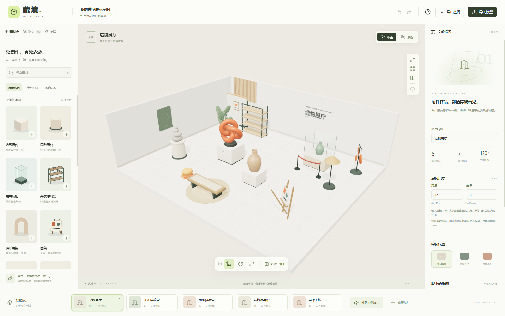
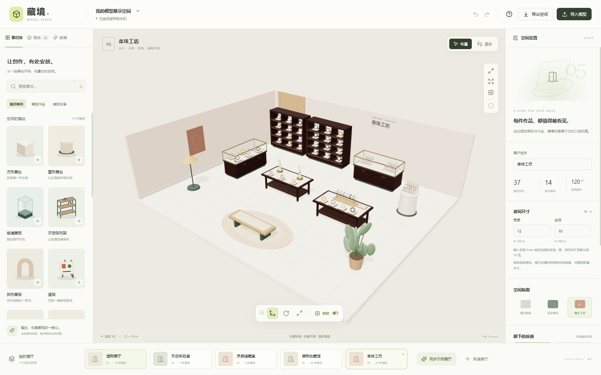

<div align="center">

<p><sub>A LITTLE SPACE FOR THINGS YOU LOVE</sub></p>

# 藏境 · Model Space

**把喜欢的东西，放进自己的小小美术馆。**

一个在浏览器里自由布展、收藏与漫游的 3D 空间。<br />
从一件雕塑、一串珠子、一张旧椅子开始，慢慢布置成你的样子。

[项目主页](https://chenzhiyong1994.github.io/model-space/) · **[进入在线展厅 ↗](https://chenzhiyong1994.github.io/model-space/app/)** · [使用指南](docs/user-guide.md) · [参与贡献](CONTRIBUTING.md)


[](LICENSE)

<br />



<p><sub>暖白墙面，柔和光影，还有等待被安放的收藏。</sub></p>

</div>

## 一间空间，许多种可能

藏境把模型展示变成一件轻松的事：挑选物件、安排展台、调整光下的角度，再走进自己布置的房间。它是一个纯前端应用，作品保存在你的浏览器中，可以导出完整备份继续创作。

| | 可以在这里做什么 |
| --- | --- |
| **自由布展** | 移动、旋转、缩放与复制物体，用展柜、层架和陈列桌安排收藏；支持吸附与撤销。 |
| **带上你的作品** | 导入自包含 GLB 模型，保留原有 PBR 材质，同一个模型可多次放置。 |
| **布置生活的角落** | 27 件精选 CC0 装潢模型、原创布置小物、4 套搭配和 4 种地面。 |
| **走进画面** | 切换第一人称漫游，用键盘行走、拖动环顾，近距离观察模型细节。 |
| **收藏一点惊喜** | 免费扭蛋，收集 6 款小珍藏，再为它们找到合适的位置。 |
| **留下自己的空间** | 布局自动保存；导出 `.modelspace`，一起带走布局和导入模型原文件。 |

<div align="center">



<p><sub>物件、展台与家具都是独立实例，可以慢慢调整每一处细节。</sub></p>

</div>

## 从五个示例展厅开始

**造物展厅**的雕塑与器物、**形态实验室**的几何与动态装置、**灵感储藏室**的自由陈列、**萌物收藏馆**的玩具与小动物，还有**串珠工坊**的六色珠串与精细展柜。

它们是可以修改的起点。也可以新建一间空房间，自定名称、空间氛围与尺寸，从零布置。导入自己的 GLB，或直接使用内置素材，都无需配置后端服务。

## 本地运行

需要 **Node.js 22.12 或更高版本**和支持 WebGL 的现代浏览器。

```bash
git clone https://github.com/chenzhiyong1994/model-space.git
cd model-space
npm ci
npm run dev
```

打开 **http://127.0.0.1:5188/**。开发服务固定使用这个地址，方便持续读取同一浏览器存档。Windows 也可以双击 `启动藏境.cmd`；启动与停止方式见[使用指南](docs/user-guide.md#本地启动与停止)。

```bash
npm test           # 数据、模型、备份与场景行为测试
npm run build      # TypeScript 检查与生产构建
npm run build:pages # 为 GitHub Pages 构建项目主页与在线展厅
npm run preview    # 预览构建结果；先停止占用 5188 的开发服务
```

普通构建在根路径提供展厅，在 `/site/` 提供项目主页；Pages 构建在站点根路径展示主页，`/app/` 展示展厅。[部署与 Fork 配置](CONTRIBUTING.md#部署项目主页与展厅)。

## 三分钟上手

1. **挑一间展厅。** 用底部房间栏切换，或新建空房间。
2. **放一件喜欢的物品。** 点击素材卡片添加，在画面中选中它，用 `G / R / S` 移动、旋转、缩放；`F` 看清细节。
3. **走进去看看。** 点击「漫游」，用 `WASD` 行走，按住画面拖动环顾；`Esc` 返回布置。
4. **带走你的布置。** 点击「导出空间」，保存一份完整 `.modelspace` 备份。

详细说明：[操作与备份](docs/user-guide.md) · [装潢与收藏](docs/decor-workshop.md) · [沉浸漫游](docs/immersive-gallery.md) · [GLB 素材接入](docs/aigc-gallery.md)

## 关于你的数据

布局保存在 **LocalStorage**，导入模型原文件保存在 **IndexedDB**。应用没有账号、云同步或模型上传接口；内置场景模型、纹理与反射环境均由项目提供，不依赖外部模型 CDN。

浏览器存储属于当前站点地址。在线展厅和本地开发环境拥有各自的存档；跨浏览器、跨设备迁移请导出并恢复完整备份。清理浏览器数据前，也请先导出重要作品。

目前支持 **自包含 GLB 2.0，单个文件最大 50 MiB**。不支持 `.blend`、`.fbx`、`.obj`、外部纹理引用或 Draco / Meshopt / KTX2 压缩；骨骼模型按静态姿态展示。第一人称漫游主要面向桌面键鼠，大量复杂模型的流畅度取决于设备性能。更多边界见[使用指南](docs/user-guide.md#当前边界)。

## 项目结构

```text
src/
  App.tsx             展厅管理、素材库与属性面板
  types.ts            房间、物体与素材共享契约
  catalog.ts          内置素材与五馆示例
  decorCatalog.ts     装潢、套装、地面与扭蛋定义
  project.ts          校验、场景操作与历史
  useProject.ts       React 状态与自动保存
  assets.ts           GLB 校验与 IndexedDB 模型存储
  backup.ts           完整备份与恢复
  scene/              Three.js 场景、几何、相机与操作柄
public/               随项目提供的模型、纹理与图片
site/                 独立项目主页
tests/                行为测试与小型 GLB 验证素材
docs/                 使用说明与素材来源
```

使用 React 19、TypeScript、Vite、Three.js、React Three Fiber 与 Drei 构建。欢迎通过 [Issues](https://github.com/chenzhiyong1994/model-space/issues) 分享问题和想法，或按照[贡献指南](CONTRIBUTING.md) 提交改进。

## 开源与致谢

原创代码采用 [MIT License](LICENSE)。随附的第三方模型与纹理遵循各自的 **CC0 1.0** 许可；作者、原始链接、加工说明与完整性记录见[素材来源](docs/asset-sources.md)。这些素材的许可范围独立于项目代码许可。

感谢 Poly Haven、Innerscene、Khronos glTF Sample Assets 及其创作者，让每一处小小陈列都拥有丰富的细节。

<div align="center">
<br />
<sub>藏境 · 给珍视之物，一处安静的位置。</sub>
</div>
